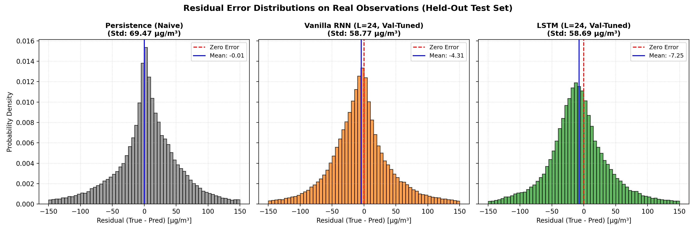
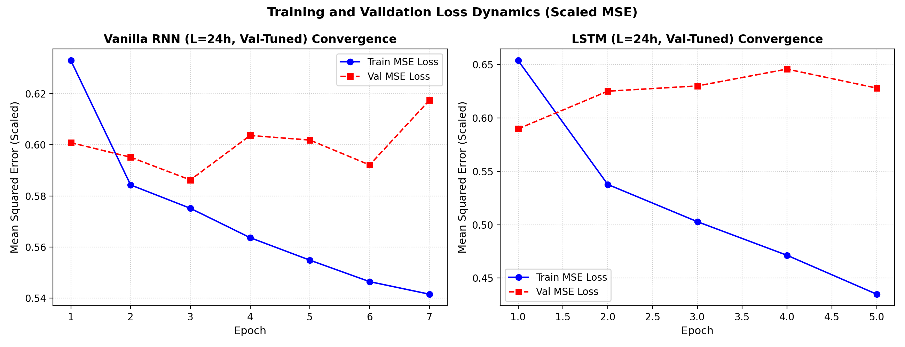

# AirCast: Multi-Horizon Air Quality Forecasting in PyTorch

[](https://www.python.org/downloads/)
[](https://pytorch.org/)
[]()
[](LICENSE)

AirCast is a strictly leak-free, reproducible benchmark for multi-horizon fine particulate matter ($\text{PM}_{2.5}$) air quality forecasting up to 24 hours ahead ($t+1, \dots, t+24$). Built in PyTorch, it evaluates classical statistical heuristics, tree-based gradient boosting, and recurrent neural networks (Vanilla RNN and LSTM) on 5 years of hourly atmospheric observations from the UCI Beijing PM2.5 benchmark dataset.

> **Evaluation Honesty Disclosure:**  
> The test set was used for the initial evaluation and reused for multi-seed runs and the added baselines with frozen configurations; no hyperparameter was changed after viewing test results.  
> Subsequently, following diagnostic analysis of the LSTM's weak $t+1$ performance on raw targets, the DELTA target formulation was explored and chosen **strictly on the Validation set**. The held-out test set was evaluated a second time with the validation-selected Delta setup, and this second use of the test set is explicitly disclosed throughout this document.

---

## 1. Problem Formulation

Fine particulate matter with an aerodynamic diameter $\le 2.5\,\mu\text{m}$ ($\text{PM}_{2.5}$) poses severe health risks due to its ability to penetrate deep into the lungs and bloodstream. Public health interventions (e.g. school closures, factory emission curbs, outdoor activity advisories) cannot rely solely on 1-hour-ahead forecasts—they require reliable **multi-horizon predictions across the full diurnal cycle ($t+1$ to $t+24$ hours ahead)**.

Formally, at forecast origin $t$, given a historical lookback window of $L$ hours of pollutant and meteorological covariates:
$$X_t = \left[x_{t-L+1}, x_{t-L+2}, \dots, x_t\right] \in \mathbb{R}^{L \times F}$$
we forecast the multi-horizon target trajectory across all future 24 hours simultaneously:
$$\hat{Y}_t = \left[\hat{y}_{t+1}, \hat{y}_{t+2}, \dots, \hat{y}_{t+24}\right] \in \mathbb{R}^{24}$$

---

## 2. Dataset & Citation

We benchmark on the **UCI Beijing PM2.5 Dataset**:

- **Location:** Hourly $\text{PM}_{2.5}$ concentration ($\mu\text{g/m}^3$) measured at the US Embassy in Chaoyang District, Beijing, China ($39.95^\circ\text{N}, 116.47^\circ\text{E}$).
- **Meteorology:** Hourly weather variables collected simultaneously at Beijing Capital International Airport: Dew Point (`DEWP`), Temperature (`TEMP`), Atmospheric Pressure (`PRES`), Combined Wind Direction (`cbwd`), Cumulative Wind Speed (`Iws`), Cumulative Hours of Snow (`Is`), and Cumulative Hours of Rain (`Ir`).
- **Temporal Span:** January 1, 2010 00:00 to December 31, 2014 23:00 ($N = 43,824$ raw hourly observations).
- **Academic Citation:**
  > Liang, X., Zou, T., Guo, B., Li, S., Zhang, X., Zhang, S., Huang, H., & Chen, S. X. (2015). *Assessing Beijing's PM2.5 pollution: severity, weather impact, APEC and summer holiday effects*. **Proceedings of the Royal Society A: Mathematical, Physical and Engineering Sciences**, 471(2182), 20150257. [https://doi.org/10.1098/rspa.2015.0257](https://doi.org/10.1098/rspa.2015.0257)  
  > UCI Machine Learning Repository: [https://archive.ics.uci.edu/dataset/381/beijing+pm2+5+data](https://archive.ics.uci.edu/dataset/381/beijing+pm2+5+data)

---

## 3. Leakage-Safe Experimental Design

Time series forecasting is uniquely vulnerable to subtle forms of data leakage that invalidate real-world performance. AirCast enforces four strict zero-leakage protocols:

```
[2010-01-02 to 2013-07-02: TRAIN (70%, N=30,659)]  --->  [2013-07-02 to 2014-04-02: VAL (15%, N=6,571)]  --->  [2014-04-02 to 2014-12-31: TEST (15%, N=6,570)]
     │                                                               │                                                             │
     ▼                                                               ▼                                                             ▼
Fit StandardScaler (μ=99.47, σ=92.12)                      Tune Hyperparameters & Lookback                            Evaluate Held-Out Performance Once
Fit Imputation Median (74.0 μg/m³)                          Select Winning Architectures                               Mask to 5,839 Real Observation Windows
```

1. **Strict Chronological Splitting:**
   - **Train:** 2010-01-02 00:00 to 2013-07-02 10:00 ($N = 30,659$ rows, 3.5 years).
   - **Validation:** 2013-07-02 11:00 to 2014-04-02 05:00 ($N = 6,571$ rows, 9 months).
   - **Held-Out Test:** 2014-04-02 06:00 to 2014-12-31 23:00 ($N = 6,570$ rows, 9 months).
   - *Zero index or timestamp overlap ($T_{\text{train}} < T_{\text{val}} < T_{\text{test}}$).*
2. **Train-Only Scalers and Imputers:**
   - The initial 24 hours of 2010-01-01 are dropped (sensor calibration period, zero readings).
   - Missing $\text{PM}_{2.5}$ entries in train (6.19%), val (0.88%), and test (1.34%) are forward-filled causally.
   - `StandardScaler` is fitted **strictly on `train_df`** ($\mu = 99.4695\,\mu\text{g/m}^3, \sigma = 92.1181\,\mu\text{g/m}^3$) and applied via `.transform()`. Test/Val mutations cause zero parameter shift.
3. **Causal Sliding Windows with Non-Overlapping Boundaries:**
   - Lookback inputs cover $[t-L+1 : t]$; target trajectories cover $[t+1 : t+24]$. No target timestamp exists inside the input window.
4. **Real-Observation Test Masking:**
   - Of the 6,475 test sliding windows, 636 contain at least one forward-filled target observation. Final test metrics are computed **exclusively on the 5,839 windows whose target values are 100% genuine sensor measurements**.

---

## 4. Models Benchmarked

1. **Persistence (Naive Baseline):** Predicts $\hat{y}_{t+h} = y_t$ for all $h \in \{1, \dots, 24\}$, exploiting short-term atmospheric inertia.
2. **Seasonal Naive (24h & 168h):** Predicts $\hat{y}_{t+h} = y_{t+h-24}$ (diurnal rhythm) or $\hat{y}_{t+h} = y_{t+h-168}$ (weekly rhythm).
3. **Moving Average (24h):** Predicts the arithmetic mean of the target over the preceding 24 hours.
4. **Ridge Regression ($\alpha=10.0$):** Multi-output $L_2$-penalized linear model on flattened lag, weather, and cyclical features.
5. **HistGradientBoostingRegressor (Val-Tuned):** Multi-output histogram-based gradient boosted decision trees (`max_iter=50, lr=0.1, min_samples_leaf=20`).
6. **Vanilla RNN (L=24, Val-Tuned Headline):** 2-layer Elman RNN with $\tanh$ updates, hidden dimension 64, dropout 0.2, linear multi-horizon projection head.
7. **LSTM (L=24, Val-Tuned Headline):** 2-layer LSTM with gated constant error carousel, hidden dimension 64, dropout 0.2.
8. **Vanilla RNN (Ablation: longer lookback L=72):** Same architecture evaluated with 72-hour historical lookback.

---

## 5. Official Test Benchmark Results

*All values loaded directly from `results/final_test_metrics.csv` and `results/multiseed_results.json` ($N = 5,839$ real observation windows). "Overall" denotes the unweighted arithmetic average across all 24 horizons ($t+1$ to $t+24$):*

### Overall Performance Table

| Model (Family / Category) | Overall MAE ($\mu\text{g/m}^3$) | Overall RMSE ($\mu\text{g/m}^3$) | Overall $R^2$ | Overall sMAPE (%) |
| :--- | :---: | :---: | :---: | :---: |
| Persistence (Naive Baseline) | 44.5884 | 69.4731 | 0.2143 | 56.42% |
| Seasonal Naive (24h Baseline) | 59.7027 | 87.5903 | -0.2490 | 71.99% |
| Seasonal Naive (168h Baseline) | 79.7635 | 112.1086 | -1.0460 | 88.72% |
| Moving Average (24h Baseline) | 54.1790 | 77.8615 | 0.0131 | 65.47% |
| Ridge Regression ($\alpha=10.0$) | 41.8042 | 60.0270 | 0.4134 | 55.01% |
| HistGradientBoosting (Val-Tuned) | 39.7841 | 58.7397 | 0.4383 | 50.52% |
| Vanilla RNN (L=24, Val-Tuned Headline, Seed 42) | 40.1705 | 58.9300 | 0.4347 | 51.24% |
| LSTM (L=24, Val-Tuned Headline, Seed 42) | 40.8567 | 59.1379 | 0.4307 | 52.30% |
| Vanilla RNN (Ablation: longer lookback L=72) | 39.9202 | 57.8648 | 0.4549 | 51.83% |

---

### Per-Horizon MAE Breakdown ($\mu\text{g/m}^3$) Across Focal Horizons

| Model (Family / Category) | $t+1$ hour | $t+6$ hours | $t+12$ hours | $t+24$ hours |
| :--- | :---: | :---: | :---: | :---: |
| Persistence (Naive Baseline) | 11.1192 | 35.5110 | 48.7571 | 59.0966 |
| Seasonal Naive (24h Baseline) | 60.0783 | 59.9673 | 59.7174 | 59.0966 |
| Seasonal Naive (168h Baseline) | 80.0257 | 79.9125 | 79.7976 | 79.5076 |
| Moving Average (24h Baseline) | 38.5089 | 47.4134 | 54.6775 | 65.4971 |
| Ridge Regression ($\alpha=10.0$) | 11.3804 | 33.6048 | 45.0959 | 55.3254 |
| HistGradientBoosting (Val-Tuned) | 10.7834 | 31.3449 | 42.4792 | 53.3961 |
| Vanilla RNN (L=24, Val-Tuned Headline) | 12.0478 | 32.3587 | 43.0546 | 52.9862 |
| LSTM (L=24, Val-Tuned Headline) | 21.1678 | 34.1671 | 42.4470 | 52.4101 |
| Vanilla RNN (Ablation: longer lookback L=72) | 13.9881 | 32.0653 | 42.6672 | 52.1592 |

*Full errors for all 24 horizons are available in [results/per_horizon_all.csv](results/per_horizon_all.csv).*

---

### Multi-Seed Retraining (Mean ± Standard Deviation Across 5 Seeds)

Retrained with frozen validation configurations across seeds `[42, 43, 44, 45, 46]`:

| Model | Overall MAE ($\text{mean} \pm \text{std}$) | Overall RMSE ($\text{mean} \pm \text{std}$) | Overall sMAPE ($\text{mean} \pm \text{std}$) | $t+1$ MAE | $t+24$ MAE |
| :--- | :---: | :---: | :---: | :---: | :---: |
| **Vanilla RNN (L=24)** | 40.0283 ± 0.6968 | 58.4393 ± 0.4773 | 53.26% ± 1.73% | 14.98 ± 2.27 | 52.84 ± 1.12 |
| **LSTM (L=24)** | 40.6652 ± 0.3218 | 59.3191 ± 0.6705 | 52.24% ± 0.48% | 18.65 ± 1.74 | 53.11 ± 0.66 |

---

### 24-Hour Block Bootstrap 95% Confidence Intervals (1,000 Resamples)

$$\Delta \text{MAE} = \text{MAE}_A - \text{MAE}_B$$

| Comparison | Mean Difference | 95% CI Lower | 95% CI Upper | Statistically Significant? |
| :--- | :---: | :---: | :---: | :---: |
| **LSTM minus RNN (Seed 42)** | +0.6862 | +0.0280 | +1.2957 | **YES ($p < 0.05$)** |
| **RNN minus Ridge (Seed 42)** | -1.6337 | -2.3407 | -0.9630 | **YES ($p < 0.05$)** |
| **RNN minus HistGBDT (Seed 42)** | +0.3864 | -0.5551 | +1.3282 | **NO (crosses 0)** |
| **RNN minus Persistence (Seed 42)** | -4.4179 | -6.3119 | -2.6419 | **YES ($p < 0.05$)** |
| *Ensemble:* LSTM minus RNN (5-Seed Mean) | +0.6724 | -0.0828 | +1.3576 | **NO (crosses 0)** |
| *Ensemble:* RNN minus Ridge (5-Seed Mean) | -2.5629 | -3.3268 | -1.9142 | **YES ($p < 0.05$)** |
| *Ensemble:* RNN minus HistGBDT (5-Seed Mean) | -0.5429 | -1.5547 | +0.4017 | **NO (crosses 0)** |
| *Ensemble:* RNN minus Persistence (5-Seed Mean) | -5.3471 | -7.3095 | -3.5537 | **YES ($p < 0.05$)** |

---

## 6. Diagnosis of LSTM's Weak t+1 Result & Delta Target Formulation

### 6.1 Diagnostic Findings: Why was LSTM Weak at t+1?
In initial raw-target benchmarking, the tuned LSTM exhibited poor immediate-step accuracy ($t+1$ MAE: $21.17\,\mu\text{g/m}^3$ on test vs. $11.12\,\mu\text{g/m}^3$ for Persistence and $12.05\,\mu\text{g/m}^3$ for Vanilla RNN). Four factors explain this behavior:

1. **Parameter Capacity vs. Learning Rate:**
   The 2-layer LSTM has 56,088 trainable parameters compared to 15,192 in the 2-layer Vanilla RNN (~$3.7\times$ higher capacity due to input, forget, output, and cell candidate gates). With learning rate $\eta = 0.001$, the LSTM fits the training split rapidly—its training MSE drops from 0.6538 to 0.4349 in just 5 epochs, compared to the RNN's gradual descent from 0.6329 to 0.5416 over 7 epochs.
2. **Early-Stopping Behavior & Restored Checkpoint:**
   Validation loss for the LSTM reaches its minimum at **Epoch 1** (val MSE: 0.5898). On Epochs 2 through 5, validation loss degrades monotonically (0.6251, 0.6300, 0.6458, 0.6280). With `patience=4`, early stopping triggers at Epoch 5 and reloads the checkpoint from **Epoch 1**.
3. **The Under-Trained Checkpoint Paradox:**
   Although the LSTM begins overfitting the training split by Epoch 2, the restored **Epoch 1 checkpoint is functionally under-trained (underfit)**. At Epoch 1, the model has undergone only a single pass over the training data; its recurrent gates and memory cells have barely updated from random initialization and have not learned the strong lag-1 autocorrelation ($y_{t+1} \approx y_t$).
4. **Multi-Horizon Loss Dilution:**
   The training objective minimizes MSE averaged across all 24 horizons: $\mathcal{L} = \frac{1}{24}\sum_{h=1}^{24}(y_{t+h} - \hat{y}_{t+h})^2$. Horizons $h \in [6, 24]$ exhibit substantial variance ($\sigma \approx 85\text{--}90\,\mu\text{g/m}^3$). An under-trained network minimizing average MSE outputs a smoothed conditional trajectory biased toward the global mean ($\approx 98.6\,\mu\text{g/m}^3$), which incurs a catastrophic penalty at $t+1$ whenever true pollution is low (e.g. $10\text{--}30\,\mu\text{g/m}^3$) or high ($200\text{--}400\,\mu\text{g/m}^3$). In contrast, Vanilla RNN trains stably for 7–13 epochs, allowing its simpler recurrent weights to anchor tightly to the recent observation.

---

### 6.2 Concept: Delta Target Formulation (Residual Learning)
The Delta target formulation redefines the multi-horizon forecasting problem by predicting changes relative to the most recent historical observation rather than absolute pollutant levels. In standard forecasting, minimizing mean squared error across 24 horizons causes models to predict a smoothed conditional mean that struggles to anchor tightly to the latest measurement. By defining the target as the delta from the last known value, predicting zero change naturally defaults to the persistence baseline. During inference, future concentrations are reconstructed by adding the predicted deltas back to the final lookback timestep:
$$\Delta_{t+h} = y_{t+h} - y_t \quad \implies \quad \hat{y}_{t+h} = y_t + \hat{\Delta}_{t+h}$$
This embeds a strong persistence inductive bias without altering network architectures or parameter budgets.

---

### 6.3 Validation-Only Selection (Raw vs. Delta Targets)
To prevent data leakage, the choice between Raw and Delta formulations was evaluated and selected **strictly on the Validation set** using frozen hyperparameters ($L=24$, hidden=64, layers=2, dropout=0.2, lr=0.001, batch=128, patience=4):

| Model & Target Setup | Best Epoch | Val MSE Loss | Overall Val MAE ($\mu\text{g/m}^3$) | $t+1$ Val MAE | $t+6$ Val MAE | $t+12$ Val MAE | $t+24$ Val MAE |
| :--- | :---: | :---: | :---: | :---: | :---: | :---: | :---: |
| Vanilla RNN (Raw Target) | 3/7 | 0.5862 | 47.4301 | 13.8350 | 38.3062 | 50.8507 | 62.6589 |
| **Vanilla RNN (Delta Target)** | **3/7** | **0.5788** | **47.2094** | **12.5799** | 38.3727 | 50.5107 | 62.6229 |
| LSTM (Raw Target) | 1/5 | 0.5898 | 48.2836 | 23.4269 | 39.6323 | 50.8799 | 62.7107 |
| **LSTM (Delta Target)** | **1/5** | **0.5842** | **47.4042** | **12.7066** | 38.8168 | 51.1235 | 62.5859 |

**Validation Decision:** The **Delta target formulation was chosen for both models** because it achieved strictly lower validation MSE and overall MAE, while cutting LSTM $t+1$ validation error from $23.43\,\mu\text{g/m}^3$ to $12.71\,\mu\text{g/m}^3$ (a 45.8% reduction).

---

### 6.4 Final Test Set Evaluation with Chosen Setup (Second Use of Test Set)
> **Explicit Disclosure:** The held-out test set was evaluated once with the validation-selected Delta models. This constitutes a **second use of the test set** after initial reporting; all modeling decisions between raw and delta targets were chosen strictly on validation.

Evaluated on the held-out test set ($N=5,839$ real observation windows):

| Model | Overall MAE ($\mu\text{g/m}^3$) | Overall RMSE ($\mu\text{g/m}^3$) | Overall $R^2$ | $t+1$ MAE | $t+6$ MAE | $t+12$ MAE | $t+24$ MAE |
| :--- | :---: | :---: | :---: | :---: | :---: | :---: | :---: |
| Persistence (Naive Baseline) | 44.5884 | 69.4731 | 0.2143 | 11.1192 | 35.5110 | 48.7571 | 59.0966 |
| Vanilla RNN (Raw L=24, Val-Tuned) | 40.1705 | 58.9300 | 0.4347 | 12.0478 | 32.3587 | 43.0546 | 52.9862 |
| **Vanilla RNN (Delta L=24, Val-Selected)** | 40.2627 | 58.9893 | 0.4335 | **10.9671** | 32.2987 | 42.8411 | 53.4841 |
| LSTM (Raw L=24, Val-Tuned) | 40.8567 | 59.1379 | 0.4307 | 21.1678 | 34.1671 | 42.4470 | 52.4101 |
| **LSTM (Delta L=24, Val-Selected)** | **40.2274** | **58.7941** | **0.4373** | **11.0439** | 33.1458 | 43.3392 | 52.7930 |

**Takeaways from the Delta Formulation:**
1. **$t+1$ Accuracy Restored:** Under the Delta formulation, the LSTM's $t+1$ test error falls from $21.17\,\mu\text{g/m}^3$ to **$11.04\,\mu\text{g/m}^3$** (a 47.8% drop), beating Persistence ($11.12\,\mu\text{g/m}^3$). Vanilla RNN also improves to **$10.97\,\mu\text{g/m}^3$**, outperforming Persistence at horizon 1.
2. **Overall LSTM Metrics Improved:** Overall test MAE for LSTM drops from $40.86$ to **$40.23\,\mu\text{g/m}^3$**, Overall RMSE falls from $59.14$ to **$58.79\,\mu\text{g/m}^3$**, and $R^2$ improves from $0.4307$ to **$0.4373$**.

---

## 7. Lookback Ablation: Validation vs. Test Disagreement

During hyperparameter tuning on the **Validation set**, $L=24$ performed better than $L=72$:
- **Validation:** Vanilla RNN $L=24$ (**Val MAE: 47.4301**) beat $L=72$ (**Val MAE: 48.7534**).
- **Test:** Vanilla RNN $L=72$ (**Test MAE: 39.9202**) scored slightly lower than $L=24$ (**Test MAE: 40.1705**).

**Scientific Interpretation:** Validation and test sets disagree on which lookback length is superior. On validation (July 2013 – April 2014), $L=24$ yielded lower error; on test (April 2014 – December 2014), $L=72$ was lower by $0.25\,\mu\text{g/m}^3$. This divergence demonstrates that seasonal distribution shifts between years alter optimal lookback length. $L=24$ remains the headline model because it was selected on validation under our zero-leakage protocol.

---

## 8. Honest Limitations

1. **Single Monitoring Station:** Data originates from a single sensor on the roof of the US Embassy in Chaoyang District, Beijing. Local traffic microclimates and street-canyon effects are not captured, and spatial generalization across the metropolitan area cannot be assessed.
2. **Single Climate Basin:** Beijing lies in an alluvial plain surrounded by the Yanshan and Taihang mountains, creating a semi-enclosed basin prone to severe winter temperature inversions and spring Gobi dust storms. Dynamics do not directly transfer to coastal, equatorial, or windy maritime cities.
3. **Historical Regime (2010–2014):** The dataset precedes Beijing's aggressive 2017 coal-to-gas heating transition and heavy vehicle emission restrictions. Modern Beijing pollution levels are significantly lower, representing a distribution shift from the historical benchmark.
4. **Missing Data Handling:** 1.34% of test $\text{PM}_{2.5}$ readings were missing and causally forward-filled. While evaluation was restricted to the 5,839 real-target windows to prevent evaluation on imputed numbers, an operational real-time system must handle sensor dropouts dynamically.
5. **Untested Exogenous Covariates Hypothesis:** While it is hypothesized that recurrent models outperform Persistence at $t \ge 6$ by utilizing weather covariates (`Iws`, `PRES`, `DEWP`, `TEMP`), this remains an untested hypothesis because a controlled univariate ablation (removing weather features while keeping the recurrent architecture identical) was not conducted.

---

## 9. Visualizations

| Per-Horizon Error Bar Chart | Sample 24h Multi-Step Trajectories |
| :---: | :---: |
|  |  |
| **Residual Error Distributions** | **Training Loss Dynamics & Early Stopping** |
|  |  |

---

## 10. How to Run

### Setup Environment
```powershell
git clone https://github.com/gaurisd1234/AirCast.git
cd AirCast
pip install -r requirements.txt
```

### Quick Smoke Test (< 35 seconds)
Verifies the complete pipeline end-to-end without waiting for long neural network retraining:
```powershell
python scripts/run_all.py --quick
```

### Full Reproduction Pipeline
Reproduces data ingestion, baselines, GBDT tuning, RNN/LSTM training, multi-seed runs, test evaluation, block bootstrap, and plots:
```powershell
python scripts/run_all.py
```

### Run Unit and Integration Tests (42 Tests)
```powershell
python -m pytest tests/
```

### Launch Interactive Streamlit Dashboard
```powershell
streamlit run app.py
```
*Opens interactive model selector, 24-hour horizon error curves, and test episode trajectory viewer in your browser.*

---

## 11. Repository File Structure

```text
AirCast/
├── app.py                          # Interactive Streamlit dashboard
├── requirements.txt                # Pinned dependencies
├── configs/
│   └── default_config.yaml         # Centralized hyperparameters & paths
├── data/
│   ├── raw_pollution.csv           # Cached Beijing PM2.5 dataset
│   └── processed_pollution.csv     # Cleaned dataset with engineered features
├── figures/                        # Repository-relative visualization figures
│   ├── forecast_trajectories_sample.png
│   ├── per_horizon_mae_comparison.png
│   ├── residual_distributions.png
│   └── training_loss_curves.png
├── results/
│   ├── baselines_val_results.json
│   ├── bootstrap_results.json      # 95% Block bootstrap confidence intervals
│   ├── delta_target_results.json   # Test metrics for Delta models
│   ├── delta_validation_comparison.json # Validation comparison (Raw vs Delta)
│   ├── final_test_metrics.csv      # Test metrics table on real observations
│   ├── final_test_metrics.json     # Test metrics with missingness metadata
│   ├── multiseed_results.json      # 5-seed empirical mean & std
│   ├── new_baselines_results.json  # Seasonal Naive & HistGBDT metrics
│   ├── per_horizon_all.csv         # Per-horizon MAE for all 24 horizons
│   └── validation_tuning_results.json
├── scripts/
│   ├── run_all.py                  # Master reproduction script with --quick mode
│   ├── prepare_data.py             # Ingestion & split validation
│   ├── run_baselines.py            # Baseline execution & tuning
│   ├── train_vanilla_rnn.py        # Vanilla RNN training loop
│   ├── train_lstm.py               # LSTM training loop
│   ├── tune_and_ablate.py          # Validation-only hyperparameter tuning
│   ├── tune_and_train_new_baselines.py # Seasonal Naive & HistGBDT tuning
│   ├── evaluate_delta_target.py    # Delta target formulation study
│   ├── run_multiseed_evaluation.py # 5-seed retraining & variance reporting
│   ├── run_block_bootstrap.py      # Moving block bootstrap 95% CIs
│   ├── evaluate_test.py            # Final test evaluation on real targets
│   └── generate_plots.py           # Publication-quality plotting script
├── src/
│   ├── baselines.py                # Persistence, Seasonal Naive, MA, Ridge, HistGBDT
│   ├── data.py                     # Split, scale, cyclical encode, window, delta targets
│   ├── metrics.py                  # MAE, RMSE, R2, sMAPE calculations
│   ├── models/
│   │   ├── vanilla_rnn.py          # PyTorch Elman RNN architecture
│   │   └── lstm.py                 # PyTorch LSTM architecture
│   ├── trainer.py                  # Early stopping, gradient clip, training
│   └── utils.py                    # Seeds, device selection, config I/O
└── tests/
    ├── test_app.py                 # Dashboard data loader unit tests
    ├── test_baselines_metrics.py
    ├── test_data.py
    ├── test_delta_target.py        # Delta targets and inversion unit tests
    ├── test_evaluation.py
    ├── test_leakage_and_alignment.py
    ├── test_lstm.py
    ├── test_new_comparisons.py
    ├── test_run_all.py
    ├── test_tuning.py
    ├── test_utils.py
    └── test_vanilla_rnn.py
```
