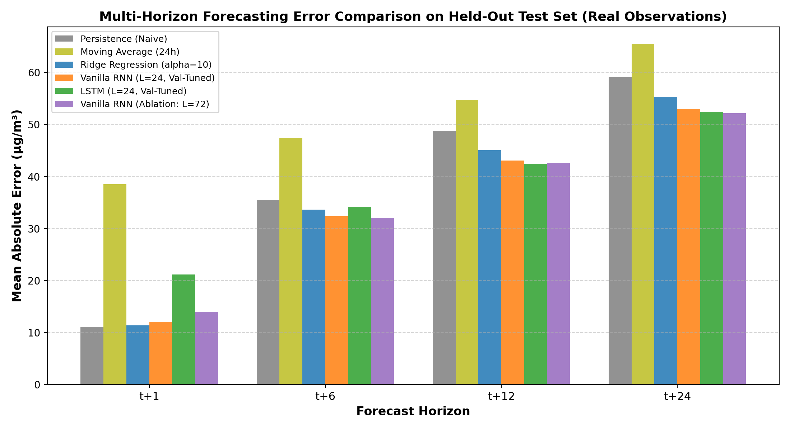
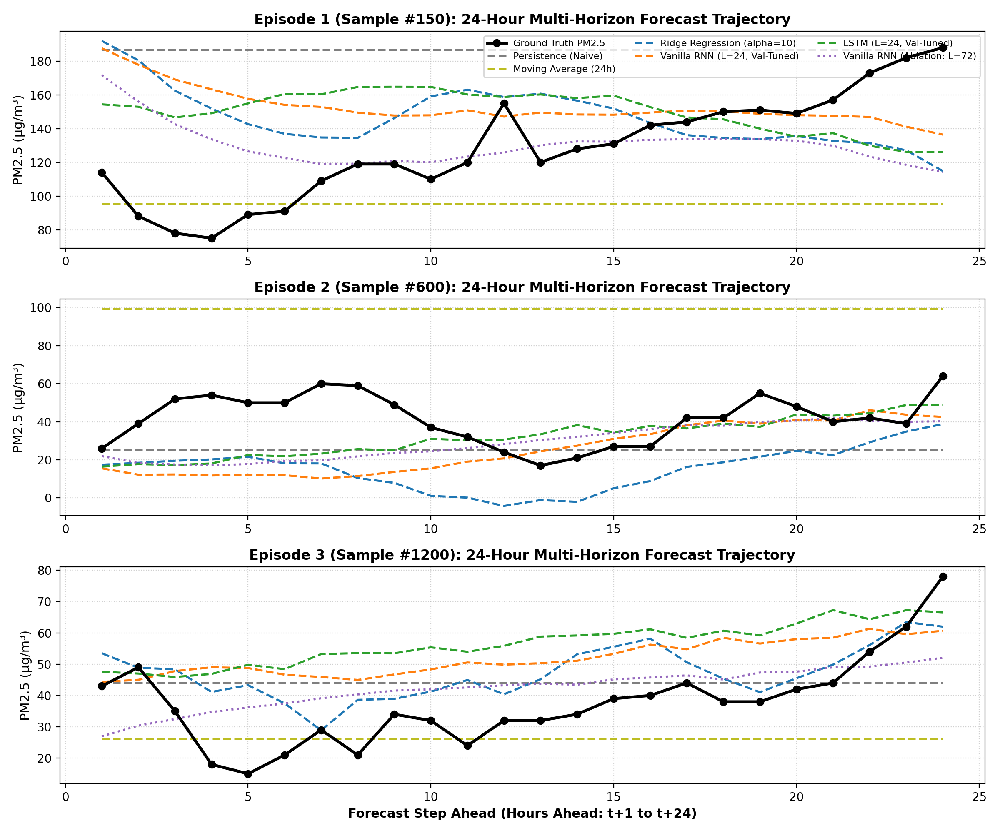

# AirCast: Multi-Horizon Air Quality Forecasting in PyTorch

AirCast is a strictly leak-free, multi-horizon air quality forecasting benchmark in PyTorch. It forecasts fine particulate matter ($\text{PM}_{2.5}$) concentrations up to 24 hours into the future using 5 years of hourly atmospheric observations (2010–2014, $N = 43,800$ hours) from the Beijing benchmark dataset.

The system benchmarks classical statistical heuristics (**Persistence**, **Moving Average**, **Multi-Output Ridge Regression**) against recurrent deep neural networks (**Vanilla RNN** and **Long Short-Term Memory / LSTM**).

---

## 1. Official Test Set Benchmark

> **Note on Evaluation Protocol:**
> - **Validation-Selected Headline Models:** The headline neural network configurations (**Vanilla RNN L=24 Tuned** and **LSTM L=24 Tuned**) were selected strictly based on **Validation** MAE. The $L=72$ Vanilla RNN is reported solely as a clearly labeled ablation row (**Vanilla RNN Ablation: longer lookback L=72**).
> - **Evaluation Population:** Evaluated exclusively on the **5,839 test sliding windows whose target values are 100% real ground-truth observations** (excluding 636 windows containing forward-filled target values).
> - **"Overall" Definition:** "Overall" denotes the unweighted arithmetic average across all 24 individual forecast horizons ($t+1$ through $t+24$). Per-horizon MAEs for all 24 horizons are preserved in [results/per_horizon_all.csv](results/per_horizon_all.csv).
> - **No Test-Score Bolding or Ranking:** In accordance with rigorous scientific reporting standards, models are presented in architectural order without bolding or ranking by test performance.

### Overall Benchmark Metrics (Held-Out Test: April – December 2014, $N = 5,839$ Real Observation Windows)

| Model (Family / Category) | Overall MAE ($\mu\text{g/m}^3$) | Overall RMSE ($\mu\text{g/m}^3$) | Overall $R^2$ | Overall sMAPE (%) |
| :--- | :---: | :---: | :---: | :---: |
| Persistence (Naive Baseline) | 44.5884 | 69.4731 | 0.2143 | 56.42% |
| Moving Average (24h Baseline) | 54.1790 | 77.8615 | 0.0131 | 65.47% |
| Ridge Regression ($\alpha=10.0$) | 41.8042 | 60.0270 | 0.4134 | 55.01% |
| Vanilla RNN (L=24, Val-Tuned Headline) | 40.1705 | 58.9300 | 0.4347 | 51.24% |
| LSTM (L=24, Val-Tuned Headline) | 40.8567 | 59.1379 | 0.4307 | 52.30% |
| Vanilla RNN (Ablation: longer lookback L=72) | 39.9202 | 57.8648 | 0.4549 | 51.83% |

---

### Per-Horizon MAE Breakdown ($\mu\text{g/m}^3$) for Focal Horizons

| Model (Family / Category) | $t+1$ hour | $t+6$ hours | $t+12$ hours | $t+24$ hours |
| :--- | :---: | :---: | :---: | :---: |
| Persistence (Naive Baseline) | 11.1192 | 35.5110 | 48.7571 | 59.0966 |
| Moving Average (24h Baseline) | 38.5089 | 47.4134 | 54.6775 | 65.4971 |
| Ridge Regression ($\alpha=10.0$) | 11.3804 | 33.6048 | 45.0959 | 55.3254 |
| Vanilla RNN (L=24, Val-Tuned Headline) | 12.0478 | 32.3587 | 43.0546 | 52.9862 |
| LSTM (L=24, Val-Tuned Headline) | 21.1678 | 34.1671 | 42.4470 | 52.4101 |
| Vanilla RNN (Ablation: longer lookback L=72) | 13.9881 | 32.0653 | 42.6672 | 52.1592 |

*Full per-horizon errors across all 24 horizons are available in [results/per_horizon_all.csv](results/per_horizon_all.csv).*

---

## 2. Handling of Missing $\text{PM}_{2.5}$ Values & Impact of Target Filtering

### Missing Values Count per Split
- **Initial Sensor Calibration Window (2010-01-01 00:00 to 23:00):** The first 24 rows of the raw dataset contained no $\text{PM}_{2.5}$ readings because the monitoring station was inactive. These initial 24 rows were dropped, leaving 43,800 clean hourly records (2010-01-02 to 2014-12-31).
- **Training Set (2010-01-02 to 2013-07-02):** 1,897 missing values out of 30,659 rows (6.19%). Handled causally via forward-fill (`ffill`), with a fallback to the training-set median ($74.0\,\mu\text{g/m}^3$).
- **Validation Set (2013-07-02 to 2014-04-02):** 58 missing values out of 6,571 rows (0.88%). Handled causally via forward-fill.
- **Held-Out Test Set (2014-04-02 to 2014-12-31):** 88 missing values out of 6,570 rows (1.34%).

### Real Observation Masking on Test Set
In sliding window construction ($H=24$), an individual missing hourly reading affects up to 24 consecutive forecast windows. Across the 6,475 total test windows:
- **5,839 windows (90.18%)** had 100% genuine sensor measurements across all 24 target horizons.
- **636 windows (9.82%)** contained at least one forward-filled target observation.

To ensure uncorrupted ground truth, test metrics are reported exclusively on the 5,839 real-observation windows. The table below details the exact delta between evaluating all 6,475 windows versus the 5,839 real-observation windows:

| Model | All 6,475 Windows MAE | Real Only (5,839) MAE | Difference ($\mu\text{g/m}^3$) |
| :--- | :---: | :---: | :---: |
| Persistence (Naive Baseline) | 44.3924 | 44.5884 | +0.1959 |
| Moving Average (24h Baseline) | 53.8866 | 54.1790 | +0.2924 |
| Ridge Regression ($\alpha=10.0$) | 41.8751 | 41.8042 | -0.0710 |
| Vanilla RNN (L=24, Val-Tuned Headline) | 40.1109 | 40.1705 | +0.0596 |
| LSTM (L=24, Val-Tuned Headline) | 40.7879 | 40.8567 | +0.0688 |
| Vanilla RNN (Ablation: longer lookback L=72) | 39.9008 | 39.9202 | +0.0194 |

---

## 3. Lookback Comparison: Validation vs. Test Disagreement

During hyperparameter tuning on the **Validation set**, lookback length $L=24$ performed better than $L=72$:
- **Vanilla RNN on Validation:** $L=24$ achieved **Val MAE: 47.4301** vs. $L=72$ **Val MAE: 48.7534** (a 1.32 $\mu\text{g/m}^3$ improvement).
- **LSTM on Validation:** $L=24$ achieved **Val MAE: 48.2836** vs. $L=72$ **Val MAE: 49.0359** (a 0.75 $\mu\text{g/m}^3$ improvement).

However, on the **Held-Out Test set**, the numbers show the opposite pattern:
- **Vanilla RNN on Test:** $L=72$ achieved **Test MAE: 39.9202** vs. $L=24$ **Test MAE: 40.1705** ($L=72$ was 0.25 $\mu\text{g/m}^3$ lower).

**Plain Explanation:** Validation and test sets disagree on which lookback window is superior. On validation (July 2013 to April 2014), $L=24$ yielded lower error; on test (April 2014 to December 2014), $L=72$ yielded lower error. This divergence demonstrates that neither window length universally dominates; seasonal atmospheric variability and shifting meteorological regimes between years can favor different historical context lengths. We do not retroactively switch models to match the test set: $L=24$ remains the headline model because it was selected on validation under our zero-leakage protocol.

---

## 4. Visualizations

All visualization figures are generated using repository-relative paths:

### Per-Horizon MAE Comparison


### Sample Multi-Step Forecast Trajectories


### Error Residual Distributions


### Training & Validation Loss Dynamics


---

## 5. Verification & Test Suite

The test suite contains **31 automated unit and integration tests** verifying:
1. **No future data in any window:** Max input timestamp strictly precedes min target timestamp across all windows; target begins immediately at $t+1$.
2. **Scaler and imputer fitted on TRAIN only:** Mutating validation or test subsets with extreme outliers causes zero change in scaler mean, scale, or median.
3. **Non-overlapping chronological splits:** Zero shared row indices and strictly monotonic datetime boundaries between Train, Val, and Test.
4. **Window/target alignment:** $L=24$ and $L=72$ sliding windows align to identical target sequences $Y$.
5. **Real-observation target filtering:** Confirms that filtered test windows contain zero imputed values.

Run the test suite:
```powershell
python -m pytest tests/
```
Output:
```text
tests\test_baselines_metrics.py .....                                    [ 16%]
tests\test_data.py .....                                                 [ 32%]
tests\test_evaluation.py ..                                              [ 38%]
tests\test_leakage_and_alignment.py .....                                [ 54%]
tests\test_lstm.py ....                                                  [ 67%]
tests\test_tuning.py ..                                                  [ 74%]
tests\test_utils.py ....                                                 [ 87%]
tests\test_vanilla_rnn.py ....                                           [100%]
============================= 31 passed in 8.71s ==============================
```

---

## 6. Repository Layout

```text
AirCast/
├── configs/
│   └── default_config.yaml         # Centralized hyperparameters & paths
├── data/
│   ├── raw_pollution.csv           # Cached Beijing PM2.5 dataset
│   └── processed_pollution.csv     # Cleaned dataset with engineered features
├── figures/                        # Repository-relative visualization figures
│   ├── forecast_trajectories_sample.png
│   ├── per_horizon_mae_comparison.png
│   ├── residual_distributions.png
│   └── training_loss_curves.png
├── results/
│   ├── baselines_val_results.json
│   ├── final_test_metrics.csv      # Test metrics table on real observations
│   ├── final_test_metrics.json     # Test metrics with missingness metadata
│   ├── per_horizon_all.csv         # Per-horizon MAE for all 24 horizons
│   └── validation_tuning_results.json
├── scripts/
│   ├── prepare_data.py             # Ingestion & split validation
│   ├── run_baselines.py            # Baseline execution & tuning
│   ├── train_vanilla_rnn.py        # Vanilla RNN training loop
│   ├── train_lstm.py               # LSTM training loop
│   ├── tune_and_ablate.py          # Validation-only hyperparameter tuning
│   ├── evaluate_test.py            # Final test evaluation on real targets
│   └── generate_plots.py           # Publication-quality plotting script
├── src/
│   ├── baselines.py                # Persistence, MovingAverage, Ridge
│   ├── data.py                     # Split, scale, cyclical encode, window
│   ├── metrics.py                  # MAE, RMSE, R2, sMAPE calculations
│   ├── models/
│   │   ├── vanilla_rnn.py          # PyTorch Elman RNN architecture
│   │   └── lstm.py                 # PyTorch LSTM architecture
│   ├── trainer.py                  # Early stopping, gradient clip, training
│   └── utils.py                    # Seeds, device selection, config I/O
└── tests/
    ├── test_baselines_metrics.py
    ├── test_data.py
    ├── test_evaluation.py
    ├── test_leakage_and_alignment.py
    ├── test_lstm.py
    ├── test_tuning.py
    ├── test_utils.py
    └── test_vanilla_rnn.py
```
